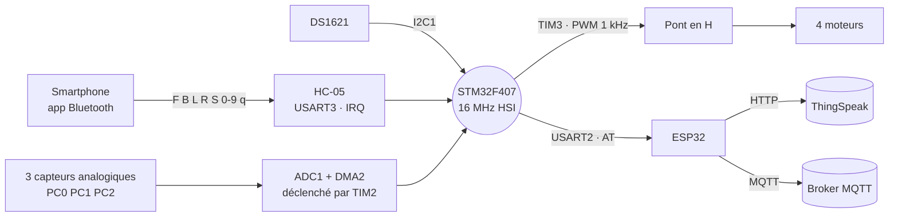

# Robot mobile IoT piloté par Bluetooth — STM32F4 en registres

Robot à 4 moteurs commandé depuis un smartphone en Bluetooth, qui mesure son environnement (3 capteurs analogiques + température) et publie ses données sur le cloud (**ThingSpeak**) et sur un broker **MQTT** via un ESP32.

Tout le firmware est écrit **au niveau registres, sans HAL ni CubeMX** : horloges, GPIO, timers, ADC, DMA, USART, I2C et interruptions sont configurés à la main à partir du manuel de référence du STM32F4.

  

---

## Fonctionnalités

| Fonction | Périphériques | Détail |
|---|---|---|
| Pilotage à distance | USART3 + HC-05/HC-06 | Réception sous interruption **RXNE**, fin de trame détectée par **IDLE** : la commande est traitée dès qu'elle est complète |
| Motorisation | TIM3, 4 canaux PWM | 1 kHz, rapport cyclique 0 à 999, virages progressifs (côté intérieur à 40 %) |
| Acquisition analogique | ADC1 + DMA2 + TIM2 | 3 voies en mode scan, déclenchées par le TRGO de TIM2 à 1 Hz, transférées en DMA circulaire sans charge CPU |
| Température | I2C1 + DS1621 | Conversion continue, lecture de l'octet de température |
| Cloud | USART2 + ESP32 (AT) | Requête HTTP vers ThingSpeak (4 champs) et publication MQTT (4 sujets) |

## Architecture



La boucle principale ne fait qu'attendre deux événements levés par les interruptions :

1. **commande Bluetooth reçue** (flag posé dans `USART3_IRQHandler`) → mise à jour immédiate des PWM ;
2. **séquence ADC terminée** (flag posé dans `DMA2_Stream0_IRQHandler`) → lecture de la température puis envoi ThingSpeak et MQTT.

## Commandes Bluetooth

| Caractère | Action |
|---|---|
| `F` | Avancer |
| `B` | Reculer |
| `L` | Tourner à gauche (virage progressif) |
| `R` | Tourner à droite (virage progressif) |
| `S` | Stop |
| `0` … `9` | Vitesse de 0 % à 100 % (rapport cyclique `n × 111`) |
| `q` | Vitesse maximale |

Compatible avec les applications « Bluetooth RC Controller » qui envoient un caractère par commande.

## Brochage

| Signal | Broche | Périphérique |
|---|---|---|
| PWM moteur A avant / arrière | PA6 / PA7 | TIM3_CH1 / CH2 (AF2) |
| PWM moteur B avant / arrière | PB0 / PB1 | TIM3_CH3 / CH4 (AF2) |
| Bluetooth TX / RX | PB10 / PB11 | USART3 (AF7), 9600 bauds |
| ESP32 TX / RX | PA2 / PA3 | USART2 (AF7), 115200 bauds |
| DS1621 SCL / SDA | PB6 / PB7 | I2C1 (AF4), 100 kHz, drain ouvert |
| Capteurs analogiques | PC0 / PC1 / PC2 | ADC1_IN10 / IN11 / IN12 |

## Données publiées

| Mesure | Champ ThingSpeak | Sujet MQTT |
|---|---|---|
| Capteur 1 (ADC 12 bits) | `field1` | `stm32/adc/pot1` |
| Capteur 2 | `field2` | `stm32/adc/pot2` |
| Capteur 3 | `field3` | `stm32/adc/pot3` |
| Température (°C) | `field4` | `stm32/temp` |

## Quelques calculs de configuration

Le cœur tourne sur l'oscillateur interne **HSI à 16 MHz** (pas de PLL).

| Réglage | Calcul | Valeur |
|---|---|---|
| PWM TIM3 | 16 MHz / ((15 + 1) × (999 + 1)) | **1 kHz** |
| Déclenchement ADC (TIM2) | 16 MHz / ((15999 + 1) × (999 + 1)) | **1 Hz** |
| USART3 Bluetooth | BRR = 16 MHz / 9600 | **1667** |
| USART2 ESP32 | BRR = 16 MHz / 115200 | **139** |
| I2C1 mode standard | CCR = 16 MHz / (2 × 100 kHz) | **80** |

## Structure du dépôt

```
├── Inc/
│   ├── board.h            constantes matérielles (horloge, PWM, sujets MQTT)
│   ├── config.example.h   modèle des identifiants Wi-Fi / ThingSpeak / MQTT
│   ├── bluetooth.h  motors.h  sensors.h  esp_net.h
├── Src/
│   ├── main.c             initialisation et boucle événementielle
│   ├── bluetooth.c        USART3 + interruptions RXNE / IDLE
│   ├── motors.c           TIM3 PWM 4 canaux et logique de déplacement
│   ├── sensors.c          ADC1 + DMA2 + TIM2, I2C1 + DS1621
│   ├── esp_net.c          USART2, commandes AT, ThingSpeak, MQTT
│   └── system.c           SystemInit minimal (FPU)
├── STM32F407VG.ld         script d'édition de liens
└── Makefile
```

## Compiler et flasher

```bash
# 1. Outils
sudo apt install gcc-arm-none-eabi libnewlib-arm-none-eabi stlink-tools

# 2. En-têtes CMSIS de ST (à côté du dépôt)
git clone --depth 1 https://github.com/STMicroelectronics/cmsis_device_f4.git ../cmsis_device_f4
git clone --depth 1 https://github.com/STMicroelectronics/cmsis_core.git ../cmsis_core

# 3. Identifiants (fichier ignoré par git)
cp Inc/config.example.h Inc/config.h    # puis renseigner SSID, mot de passe, clé ThingSpeak, IP du broker

# 4. Compilation et programmation
make
make flash
```

Le projet peut aussi être importé dans **STM32CubeIDE** : créer un projet vide pour le STM32F407VG et y copier `Inc/` et `Src/`.

## Pistes d'amélioration

- Remplacer les temporisations bloquantes (`Delay_ms`) par une machine à états sur SysTick, pour que l'envoi réseau ne retarde jamais une commande moteur.
- Lire les réponses de l'ESP32 (`OK`, `ERROR`) sous interruption pour gérer les reconnexions.
- Ajouter un arrêt de sécurité si aucune commande Bluetooth n'est reçue pendant un délai donné.
- Mesurer la vitesse des roues (encodeurs) et asservir chaque côté en PI.

## Auteur

**Mohamed DAB** — élève-ingénieur en génie électrique, ENSIT (Tunis)
[LinkedIn](https://www.linkedin.com/in/mohamed-dab-049032384) · [GitHub](https://github.com/mohamed-dab)
